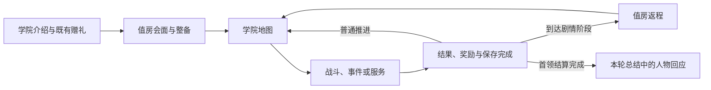

# 学院基地与人物剧情规划

2026-10-26后续修正：用户明确要求基地是可操作人物自由移动、探索并近距交互的实际场所，下文固定镜头点击房间的旧提案已被替代。当前确认口径见总案5.1.9，前端样板位于 `Tools/StoryQuestPrototype/`；本文原提纲保留追溯，不作为点击式基地的实施依据。

日期：2026-10-26。阶段：文本方案，供本轮讨论；尚未制作视觉设计稿、场景或运行时功能。

用户已确认：先有学院生活与人物牵挂，再逐步发现异常；开局和关键剧情阶段回基地，普通节点之间继续沿地图推进。本文将这两项决定展开为具体方案。房间、人物场次与触发安排属于本次提案，不自动成为正式产品规则；已确认的返程节奏仍以总案5.1.9为准。

## 1. 基地是什么

建议采用学院外环维护组的共用准备室，暂称「工读值房」。维克多在这里与同伴交班、整理携带、了解接下来的工作，也会在这里吃一顿放凉的饭、收到家书，和别人把没有说完的话继续说完。

玩家从这里出发时，知道自己为何去做眼前的事；关键阶段回来时，能看见同伴的生活与关系发生了什么变化。

首版由一个固定镜头房间承载，点击人物与物件交互。沿用现有整备页面和学院路线图，先完成一个小而完整的驻点。自由行走、宿舍装修、多建筑经营及常驻商业服务不列入本版。

它是学院中的公共工作场所，位置建议在外环维护工作的集合处，靠近通往生活区的通勤路线；精确地理位置待定。学院地图继续使用现有六个玩法区域。

## 2. 房间里的五处地方

以下是空间分工，不是正式画面布局；构图、镜头、人物遮挡与点击范围仍须在视觉设计阶段落实并审阅。

| 地方 | 玩家可以做什么 | 人物怎样在这里生活 |
|---|---|---|
| 中央交接桌 | 与本次来访者交谈，查看当前阶段的交接材料 | 有人刚回来，有人准备离开；重要分歧围绕正在发生的工作展开 |
| 侧边工具桌与行囊 | 进入原有装备、背包与术式配置，关闭后回到房间 | 维克多容易在这里反复检查，莉瑟会把自己的工具收回自己面前 |
| 靠窗长凳 | 主动找同伴闲谈、阅读已经收到的家书 | 饭盒、换班留言和个人安排承载任务之外的关系；饭食画面不附加恢复效果 |
| 资料柜 | 回看本轮已知的主线材料与已发生对话 | 只存普通记录和获准抄录，受控原始档案及危险器物留在原管理场所 |
| 门边路线图 | 查看本阶段目标并进入原学院地图，随后正常选节点出发 | 人物离开时有自己的事务；房间不要求每个人一直等待主角 |

场景默认让人物、行囊和路线图可识别，交互时再显示姓名或短动作标签。对白开启后阻止点击穿透；关闭对白恢复原房间状态。目标与危险条件仍由现有地图、节点准备页表达，不塞进角色台词。

房间变化跟随剧情：开头是普通交班；发生分歧时，莉瑟会先去做自己的事；异常出现后，交接桌上多了获准核对的材料；塔前由实际参与签署的人来访。每种变化都对应本轮已发生的事实，不能用随机摆件或未经说明的空椅暗示角色出事。

## 3. 怎么接入一轮游戏

建议按下列阶段安排会面。它们是剧情顺序，不代表同一天，也不要求按固定日历推进；不会出现饭点倒计时、迟到扣分或人物限时消失。

| 窗口 | 主要发生什么 | 留给玩家的变化 |
|---|---|---|
| 开局交班 | 先遇见莉瑟，认识这间房间；工具与行囊接原有整备，路线图接原有地图 | 我有自己的工作，也有一个熟悉我、会对我有要求的人 |
| 首段任务后的关键返程 | 用莉瑟的个人安排展开一次相处摩擦；娜塔可在本阶段交接时出现 | 把活全揽走并不一定是在帮助别人；下次可以先商量 |
| 器材记录出现矛盾后的返程 | 维尔带来获准比对材料；维克多拒绝补签；此前认识的人会受调查影响 | 继续核对有现实代价，放任问题也会伤到熟人 |
| 封存塔前准备 | 娜塔和维尔分别履行能力确认与记录边界职责；莉瑟有自己的回应 | 进入现场的目标、权限和同伴分工明确；私人信任不替代许可 |
| 本轮结束 | 人物回应实际完成的事；胜利、明确放弃或结束失败分开写 | 本轮付出落在具体的人身上，未解决的问题仍然存在 |

中段两个返程的精确进度条件尚未冻结。建议由稳定的章节进度安排，随机事件提供具体材料和额外角度；没有抽中相关事件时，由值房交接提供有来源的必要前情，不声称玩家去过未访问的节点。首领开放前应完成必要信息铺垫，避免塔前一次补播所有内容。

每次返程以当前主要会面为中心，其余人物内容由玩家主动查看。关闭或跳过对白后，任务要点仍可查；对话不替玩家确认事件选项、领取奖励或完成操作教学。未完成的可选人物场景优先保留到后续合适返程，不因一次离开无提示地永久丢失；已经越过合适阶段的内容需另写符合现状的接续，不能原样播放过期对话。

返回基地不消耗新的学院时序，不治疗、不补次数、不重抽地图、不开放额外交易。路线位置和可达性保留。节点结果、奖励和保存先完成；活动战斗、待领奖励与保存失败优先恢复对应状态。显式固定首次体验保留原节点与赠礼例外，另选安全间歇接入。

基地中的塔后表现只承载既有本轮总结，不增加继续选路或新的首领处置按钮。

## 4. 人物剧情怎样分工

维克多的共同成长是：从怕欠人情、什么都自己做，走到能够请求帮助、共同决定、承担自己那一部分。人物各有自己的事情，不能只在维克多需要信息时出现。

### 莉瑟：从一起生活，到愿意一起计划

已有事实：莉瑟·多恩是同届工读生与室友，善于谈判，对维克多过度相信制度自行纠错持保留态度。战争三种终局均已确定两人保持伴侣关系；学院何时确立关系尚未定稿。

本次提案把她作为第一条主要人物线：

1. **留一处自己的位置。** 开场在共用工具桌相处。莉瑟愿意帮忙，也会直说维克多挤占了她的工作位置和时间。饭食、课程与休息是她自己的生活，不把她写成只会照顾人的角色。
2. **一次没有商量的好意。** 维克多擅自替她多做了工作，以为能让她省事；她原本已安排好自己的交接和课程。争执之后两人仍会一起做事，但这次不会由一句道歉立刻恢复如初。该场为新增具体情节候选，不能套到玩家未做过的战斗操作上指责玩家。
3. **把时间留给对方。** 后续他先问她什么时候有空、需要怎样帮忙；她也不再默认替他补上所有遗漏。阶段回报可以是一件小事：两个人终于按商量好的时间收工，有空谈一谈资格到手后想过的生活。

异常主线进入后，莉瑟首先关心受影响的工读生是否知道自己的处境。她的谈判和组织能力因此有用，但她自己的生活不能从此被主线吃掉。亲近由共同经历和双方选择积累，首版不新增送礼、好感数值或多角色恋爱分支。

### 娜塔：从被检查，到被允许承担

已有事实：娜塔·赫斯是实地安全课程导师，允许犯错，反对篡改记录和用热情代替安全边界。

建议先让她在普通交接中看见维克多的实际本领，而不是初次出场就训话。随后围绕一次真实的分工复盘产生摩擦：维克多以为多留下检查意味着可靠，娜塔要求他同时说明同伴当时能够做什么、为何没有被告知。

后续关系变化落在职责上：娜塔让他主持能力范围内的一次交接，自己仍承担导师应负责的判断。塔前签署表示她认可这次任务的能力条件，不表示他获得无限权限。她希望学生能独立判断这一动机属于本次展开建议，不新增创伤往事或“曾失去一名学生”的背景。

### 维尔：信任受损之后，亲自承担责任

已有事实：维尔·埃斯科是封存区记录员，曾在上级压力下延迟上报，也担心公开异常会让工读生和维护员失去岗位。

第一次会面可只处理一笔普通借还记录：他知道材料该去哪里，也记得谁值过班，让玩家先认识一个能办事的人。

异常出现后，他倾向先内部补齐，维克多拒绝为未亲见的验收签字。冲突因此发生在已经建立的信任上。维尔并非外流主使；他对岗位的担心有依据，也不能成为继续遮掩的免责理由。

这一阶段的回报是他亲自区分已经核实与尚未核实的部分，并承担通知和移交责任。塔前可以有一次有限合作，完整信任修复跨越后续学院经历，不能靠交出一份材料便宣布和解。

### 卡西安：可以合作，仍有分歧

已有骨架：卡西安·罗恩拥有家族赞助，技术不差；曾隐瞒过载，被维克多如实报告后失去优先实习机会，后来承认家族要求他不能留下污点。

建议做第一条可选人物线：工具桌边的专业较量 → 报告之后的决裂 → 双方重新校对一份器材结果。结尾承认对方的能力，同时保留不同的失败成本与立场。

热压校准尚不是本次新增地图节点。正式接入时必须明确这件事由玩家参加、在场见证还是获知；当前先保留场景提纲，不把普通战胜利伪装成完成了这场校准。不看这条可选支线也能理解封存塔主线。

### 后续人物

赛芙·雅尔放在下一批：先作为有课程、家书与私人顾虑的交换生进入实践组，之后再逐步展开跨境压力。守灯人继续只承接常规开局赠礼；塔之守卫主要在受控现场出现。两者均不变成常驻基地向导。

## 5. 一段开场口吻样稿

新写的候选片段，用于看人物怎样相处；不表示玩家已完成前述剧情或新增奖励。场合是普通工读收尾，之后再进入下一段任务准备。莉瑟提到的往事是本场拟议的生活背景，正式采用时须与前后演出保持一致。

维克多把行囊放上共用桌，准备摊开工具。莉瑟伸手扶住快被挤到桌沿的记录夹。

**莉瑟：**“包先放椅子上。这边留给我，别一进门就全占了。”

**维克多：**“我只放一会儿。出发前还得查一遍。”

**莉瑟：**“上一回你也这么说，后来连我的那份都查了。”

**莉瑟：**“今天先说好，你自己的归你，我的归我。要帮忙就开口，别替我决定。”

**维克多：**“我以为你赶着去吃饭。”

**莉瑟：**“我是赶着去吃饭，也没打算把工读让给你。”

维克多把行囊放到椅子上，给她腾出桌面。

**维克多：**“那你看完叫我。”

**莉瑟：**“叫你做什么？”

**维克多：**“一起去。你不是说，再晚就没什么好吃的了。”

**莉瑟：**“这回倒记住了。先收好，今天我可不替你占座。”

这段结束后交还操作。生活中的饭点不转成实际倒计时；场景中的食物不产生治疗、道具或费用结算。对白保留人物各自的在意，不负责解释背包按钮或地图机制。

## 6. 首个制作样板

本方案采用后，第一段可玩目标建议收敛为：

**常规新档进入值房 → 莉瑟的开场交流 → 原有整备 → 地图完成普通战与奖励 → 一个明确的早期剧情间歇回值房 → 莉瑟的后续交流 → 继续原地图。**

样板只制作同一房间、维克多与莉瑟的代表性呈现，以及两段完整交流；工具桌、路线图和已发生内容回看都能实际使用。首段任务具体门槛需在产品定稿时确定，不以“第几场”临时猜值写入代码。娜塔、维尔和卡西安先保留本提纲，样板成立后逐步加入。

验收看四件事：玩家知道为何出发；整备与地图沿用真实状态；回来后的交流回应实际阶段；跳过或续档仍能继续，原路线、奖励、赠礼和关系状态不重复或丢失。不会把内部强制触发对白当作正常入口验收。

剧情状态至少区分本轮阶段、已知事实、待发生会面和已呈现内容。教学完成、长期回看与本轮人物经历分别记录；NPC不记得其他轮次。基地没有新增关系数值和永久成长，首版不预建通用好感或基地经营系统。

下一步解锁的是这个双人物样板的具体视觉设计与接入。正式采用的玩家流程应先写入飞书总案及本地镜像，世界事实写入对应主题源，再补对应数据并实现。本文仍是归档提案。

## 7. 全游戏接续与已知差异

学院里，值房让人有自己的工作和可以回来的地方；全面战争后，会面、整备与出发可以转接到既有余烬站借用工位。莉瑟、卡西安和赛芙保留原战时职责，通过实际来访与通信继续关系，不把全体人物搬到同一房间。雁口关第一份委托与既有战争进程保持原顺序，战争基地接入另行设计。

当前需要保留的差异：

- 人物档案的外形段仍引用“64px单位合同”，与当前总案及项目原生32、32 PPU、自适应画布口径不一致。本文不据旧引用制定资产规格；进入资产制作前应统一该引用。
- 旧叙事基线的“七区域”与当前六玩法区域不一致，基地提案不增加第七区域。
- 世界源有两种塔后停机处置，当前产品流程尚未纳入。本文只规划既有总结的人物回应，新增处置选择仍需先形成明确产品决定。

## 8. 依据与本次检查

- [此前剧情接入草案](剧情接入草案.md)：已确认方向与返程节奏，本方案继续展开其第10节。
- [总策划案本地镜像](../../策划案/OCC_项目总策划案_v1.0.md)：5.1.9—5.1.13，以及第8章的现行单轮流程。
- [维克多角色档案](../../OC世界观/11_角色档案/维克多·维恩.md)：性格、欲望、姓名与人物关系。
- [维克多学院故事线](../../OC世界观/11_角色档案/维克多·维恩_学院故事线.md)：工读、莉瑟摩擦、卡西安校准与维尔责任链。
- [学院当前可玩内容设定合同](../../OC世界观/04_教育与组织/学院当前可玩内容设定合同.md)：任务抽样、六区域、实操整备与访问权限。
- [灰垣主战场与三阶段战争主线](../../OC世界观/07_军事与战争/灰垣主战场与三阶段战争主线.md)：余烬站、同伴战时位置及莉瑟伴侣关系。

本次使用 `game-production-standard`、`game-story-flow`、`game-interface-planning` 的文本规划路径及 `arknights-dialogue`。对白实际读取本地《今日厨房》完整场景，参考熟人互相照料仍各有偏好、回应不总是配合对方的写法；未迁移原作人物、措辞或世界事实。

完成了相关源文核对、独立人物弧复核和本稿事实/时序回读。尚无正式画面、交互测试或运行验收；本轮不修改Unity、正式产品母版和活动数据表，不触发构建。
