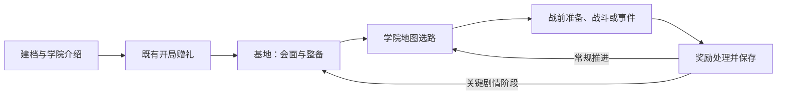

# 肉鸽模式贯穿剧情与引导：接入草案

日期：2026-10-25。状态：具体剧情仍为讨论方案，台词与情节未写入正式产品流程或游戏。用户单独确认的战败重试及基地返程节奏已同步活动源；战败重试已实现，基地仍待设计与实现。本文保存在归档中，不建立并列母版。

后续讨论重点：用户提出“剧情先随便写写，重要的是怎么接入游戏，也许需要一个出发基地”，并确认采用“开局和关键剧情阶段回基地，普通战斗之间继续走地图”。该节奏已作为待实现决定写入总案5.1.9并回读至revision 2828；下文具体场所、交互和剧情触发仍是方案，尚未制作场景或修改游戏。

核对依据：初次读取的飞书总策划案 revision 2815 相关段落、本地总案第1、5、6、8章，以及当前 OC 世界观源。战败重试按2026-10-25用户后续裁决更新，飞书已同步至 revision 2827 并回读，本地镜像与四张相关数据表已同步；已确认的故事事实与下文拟议的触发、界面和台词分别处理。

## 1. 这次要补上的体验

玩家选择维克多后，知道他为什么要接任务；走过课程、事件和整备时，逐渐认识同伴并察觉器材记录异常；挑战塔之守卫时，理解双方的目的；结束这一阶段时，知道自己实际完成了什么、还有什么没有解决。

后续接入范围建议收敛为一段完整流程：新档角色确认 → 学院介绍与常规赠礼 → 出发整备 → 随机学院路线 → 封存塔 → 本轮总结。届时固定首次体验也应接入这条叙事，但不能成为理解故事的必经入口。战争两阶段在本文保留贯穿关系，不据此扩建当前关卡；本轮只讨论内容。

玩家始终能回答三件事：我现在替谁做事、这件事为什么值得做、下一步可以去做什么。

## 2. 全游戏已有的故事骨架

| 人生阶段 | 已确认的故事事实 | 本方案要让玩家感受到的变化 | 可结合的引导范围 |
|---|---|---|---|
| 学院 | 普通工读学生追求专业资格；发现储能单元重复编号、提前结案与外流；同伴协作保留记录 | 从想把自己的生活安顿好，到发现一次省事的处理会让别人承担危险 | 地图、战斗、获得与配置、服务、风险预览 |
| 全面战争 | 独立维护者进入灰垣；学院外流单元进入战争；接下有具体委托者和边界的工作 | 熟悉的人和器材出现在更危险的地方，修复工作开始直接影响通路和伤员 | 未来已开放的委托、区域状态及任务后果，具体规则另立产品口径 |
| 战争转折 | 同伴汇集可核验的记录，进入镜井终局；已有通路页、封存页、证言页三种终局 | 不仅完成眼前工作，还要决定危险技术和人的去向 | 未来已开放的阶段变化、终局条件与选择后果 |

这些阶段来自既有主线，不另造时间循环。新局是人生档案的另一种可能，角色不会自动记得其他轮次。封存塔只收束当前可玩学院段，不自动等于毕业，更不能直接接一句“战争爆发”跳过中间经历。

## 3. 学院第一章的接入顺序（拟议）

| 节拍 | 放在哪里、由谁承接 | 玩家得到的故事变化 | 同时完成的引导 |
|---|---|---|---|
| A01 站稳脚跟 | 学院介绍、学生档案；维克多自身视角 | 交代工读身份、家人付出的成本，以及取得专业资格的愿望；开场时已经是普通在校生 | 认识当前角色和基础配置，明确本阶段是学院任务经历 |
| A02 带好东西再走 | 现有守灯人赠礼与出发整备 | 守灯人交付有来源的旧藏；维克多第一次为这份档案选择携带的帮助 | 区分获得、领取、装备和术式配置；玩家自主选择，不指定赠礼 |
| A03 有人在等你回来 | 首次地图任务摘要、首战结果与奖励；娜塔或当前任务来源人 | 任务来自具体的人，结果由具体的人接收；通过已有工读和同伴关系建立生活感 | 读目标、危险与公开意图，完成战斗和逐项领取；任务目标保持现行规则 |
| A04 对不上的记录 | 中段地图安全停顿；可结合既有事件，由维尔或当前记录材料承接 | 给出一件可理解的异常：已结案器材的记录与现场状态对不上。此时只提出问题，不宣布战争阴谋 | 事件选项仍显示真实成本和结果；不添加必须购买、支付或持有某物才能读到的主线 |
| A05 认识守塔的人 | EV08、T02 的现有叙事机会；路线未遇到时，放在首领前的任务简报中 | 早于 A04 遇到时只建立老人和值守记录的印象；获知异常后再解释他守着的风险及塔内相遇 | 早遇不提前讲首领准备；后期才解释高风险任务资格、进入条件和最后整备，不替玩家决定提前挑战 |
| A06 到现场核对 | F50／F51 的首领门槛与准备，沿用公开阶段提示 | 说明这次进入要处理什么，塔之守卫为何要求交手；把前面的异常与塔内载荷联系起来 | 公开战斗目标和新阶段规则，不直接提示击破顺序或指定技能 |
| A07 让结果落到人身上 | 首领奖励处理完成后的本轮总结；战败先提供重试，确认放弃或结束本轮后才走阶段失败摘要 | 回应本轮实际发生的事件和已完成任务；获胜不宣称破获整个外流网络，未完成不虚写成功 | 说明重试恢复本场战前状态、暂停只中断，以及结束本轮和开启新轮的区别 |

主线节拍的精确触发阈值尚未冻结。实现时必须保证 A04 在中段出现，A05 在首次首领战之前出现，不能等到 F51 才连续补完所有漏掉的故事。

人物接续：守灯人只在常规开局；娜塔负责任务与安全边界；莉瑟承接同伴生活和求助；维尔承接记录矛盾；塔之守卫负责本章收束。工坊、医务室和商店由各自岗位解释当前服务。任何人都只知道其有来源的信息。

## 4. 随机路线怎样保留完整因果

- 主线必要信息随阶段进度保证出现；随机事件补充见闻、人物关系和不同角度。玩家不必反复刷种子寻找理解故事所必需的事件。
- 优先将必要信息嵌入已有地图、任务摘要与结算；没有相关随机事件时使用专门的简短接续文本，不能声称玩家完成过没走的任务。
- 首版只使用当前学院映射内的内容。EV03、EV16 虽在世界观中承担过伏笔，未进入当前映射，不能为了补故事顺手开放。
- 故事按“已知道什么、已经历什么”推进，避免先说结论再第一次发现问题；必要前情可以回看。故事编号和教学完成状态分开保存。
- 看过、跳过与实际完成任务分开记录。跳过对白不领取奖励、不完成教学操作、不改变事件选择；续档不重复赠礼或结算。
- 固定首次体验与常规开局使用相同事实与接续状态；固定段没有守灯人赠礼时不补发，也不写成已经见过守灯人。
- 重复轮次可以缩短已看过的介绍，但本轮目标和必要前情仍可读；不让 NPC 无依据地认出“上一轮的你”。首版不新增跨轮关系成长或局外数值奖励。

## 5. 引导与对白如何配合

剧情解释人物的目的和行动缘由；既有教学系统负责当前操作、规则和实际结果。每次只推进当前需要的一项教学，不因为 NPC 讲过就标记教学完成。关闭操作教学仍保留故事，跳过故事也不影响正常操作。

普通随机战斗维持入场后直接操作，叙事主要在战前摘要、地图和战后安全窗口出现。服务交易继续可选；不强迫玩家为看剧情花钱、受伤、丢物或接受指定构筑。战斗规则、奖励、费用和路线后果必须用现有清晰字段表达，不能藏进文学对白。

下面是新写的语气样例，不是已批准台词，也不增加物品或任务：

**开局，维克多在整备页：**

> “家里和村里凑了路费，学费能用工读抵一部分。先把眼前这份活做好。”

画面继续显示真实装备、背包与术式。首次操作提示只指出当前需要查看的位置，不要求更换配置。

**同伴，首次奖励整理后的莉瑟：**

> “拿到了就先收好。要不要换上，你自己试过再说。”

对应“已获得”与“已配置”的区别，不自动替换任何东西，也不把她写成商店说明员。

**中段，维尔提供获准比对的抄录，维克多核对记录：**

> “这里写着已经结案。可这份抄录还留着它们的热损读数。”

当前目标文字转为“了解封存塔的异常记录”。材料来源是维尔提供的获准比对抄录，不暗示维克多已进入核心或查阅完整内部档案。这是故事信息，不附加新物品栏、线索货币或解谜锁。

**首领准备，塔之守卫：**

> “许可我看过了。进去之前，让我看看，你会怎么处理这里的东西。”

同页独立展示已确认的战斗目标和阶段信息；对白不承担规则说明，也不暗示老人是需要杀死的恶人。

## 6. 正式接入前需要统一的现有差异

1. **战败重试已裁决（2026-10-25）。** 用户确认常规肉鸽战败也允许恢复本场战前状态重试，与固定首次体验一致。明确放弃或结束本轮才关闭本轮；暂停或返回首页只保存中断。重试不结算成功节点或重复发奖，也不表示世界内时间循环。原母版各处的相反条款按本次裁决统一，不再等待用户选择失败口径。
2. **区域数量旧文冲突。**《OCC游戏内叙事与图标基线》仍有“七个区域”，当前总案与《学院当前可玩内容设定合同》为六个玩法区域，生活区只作为世界内场所。本文不设计第七区域；正式同步时需统一该陈旧表述。
3. **首领战后处置尚未进入产品流程。**《封存塔与终考前提》第六节有“可核验停机／强行停机”，总案第8章与当前状态表只明确胜利、领奖和总结。该双处置不能直接变成新按钮或结局分支；是否纳入本次接入需要单独决定。A07先定义结果回顾职责，具体处置内容待母版明确。

## 7. 实施范围与验收

正式采用后，先在既有主题源中维护确有变化的世界设定，再把玩家实际看到的流程、剧情触发与保存规则写入飞书总策划案并同步本地镜像，补充对应叙事数据，再接入学院流程、教学协调和本轮总结。设计原则留在本地；不把本讨论稿全文同步成飞书产品内容。

首版验收只覆盖这次叙事接入：默认常规新档能从动机走到首领及总结；一个未经过相关事件的路线仍能读懂必要因果；中途跳过或续档不重复剧情奖励、不阻断操作；教学关闭仍有故事；固定首次体验不重复赠礼和主线；已走与未走节点的总结内容一致。失败分支核对普通战、精英与首领均可恢复本场战前状态重试，明确放弃才结束本轮，暂停／返回首页只中断。

完成这一章后，才扩充随机事件的人物差异、完整学院后续经历，再沿既有世界主线制作战争章节。本剧情草案当前没有运行时接入、实机文案排版或游玩验证证据，不能标记“已实现”；单独确认的战败重试实现与验证见本目录《交付与验证》。

## 8. 人物与故事打磨（讨论候选）

本节是对前七段的创作建议，不修改既有世界事实，也不批准新任务、奖励、剧情选项或系统。先讨论故事为何成立，再确定界面承载和触发。

### 贯穿全程的情感线

维克多起初想靠本事获得自己的选择权，后来学会承认别人也该有选择权，最终愿意为共同作出的选择承担后果。

“记录”是贯穿的物件和行动，真正值得玩家关心的是：他为什么替这些人坚持，以及谁愿意和他一起坚持。学院里是同伴的工读与前途；战争中是伤员能否走、工坊能否拒绝征用；镜井终局则是这些人以后如何生活。现有通路页、封存页、证言页分别回答通路、危险技术和证言如何被持续维护，不另造第四种终局。

### 学院篇的七次关系变化

1. **想站稳脚跟。** 开头先给维克多一个能理解的眼前愿望：学好本领，靠专业资格获得能够自主选择的工作。可以用家书和与莉瑟的日常交谈承载，不集中讲家庭史或世界政治。
2. **不敢随便接受好意。** 在既有赠礼场合，他先关心器材来源和弄坏后的责任，体现工读生对借用、费用的敏感。守灯人的回答服务于这次相遇，不承担全游戏指路或神秘预言。示例口吻：“这么旧的东西，还能借吗？弄坏了要赔多少？”具体回答须与最终赠礼性质一致，不能把赠与改成借贷规则。
3. **帮忙也会让人不高兴。** 莉瑟愿意帮他，但不喜欢他不商量就把别人的工作全揽走。可用一次普通课程或工读后的摩擦，建立“互相帮忙也要尊重对方”的关系。候选台词：“我的那份留给我。我也得靠它交学费。”这一句仅用于合适的工读场合，不解释战斗收益或新费用。
4. **一次不愿意补上的签字。** 异常最好发生在他已熟悉的交接工作中：有人请他给未亲见的器材补签，现场状态与结案记录又对不上。维尔希望先内部补齐，顾虑调查会牵连工读岗位；维克多拒绝假签，也担心坚持会伤到熟人。这沿用已确认的责任链事件，让调查动机来自处境。
5. **先认识一个老人，再认识守卫。** 可先呈现守塔人耐心核对刻度的日常，后期才认出其风险批注。具体出现方式待定，不保证随机路线上发生未走过的事件。老人仍是守着危险现场的人，不是用谜语拖延真相的反派。
6. **把分歧带到现场。** 进入塔前，要明确他这次获准核对什么、为何需要现场处置、交手会检验什么；这些因果仍需继续打磨。战斗是能力与风险边界的检验，击倒不等于杀死守卫。既有世界观的两种停机处理仍未变成产品按钮。
7. **第一次主动请别人一起做。** 学院段的情感回报可以落在一个很小的变化：维克多不再独自接下全部后续工作，而是请莉瑟、维尔等人一起核对。回顾实际解决了谁的什么问题，也保留尚未解决的部分；不把塔后总结写成毕业或战争已经到来。

### 接下来优先讨论

用户已选择：**先有学院生活与人物牵挂，再逐步发现异常。** 开头先让玩家追随维克多的生活愿望，认识一起做事的人；异常随后进入已经有牵挂的生活。此项是叙事方向确认，下面三场戏仍为待讨论文本，不表示已批准具体台词或任务。

方向确定后，先打磨开场、第一次不肯补签、塔前相遇这三场代表戏；其中开场负责让人愿意陪他走，补签场合建立核心冲突，塔前相遇补齐行动因果。台词长短和引导位置随后随场景检验，不先用固定字数代替戏剧效果。

## 9. 三场代表戏初稿（具体情节与对白待讨论）

### 第一场：晚饭之前

候选场合：一次学院工读收尾。借用维克多既有的热水管与工具清点职责；不是增设新关卡或指定游戏开场必须发生在夜晚。

维克多擦干工具，准备再查最后两个接口。莉瑟回来拿自己的记录夹，发现那一段也被他看过了。

> **莉瑟：**“你把我那段也查了？”  
> **维克多：**“只剩两个接口。顺手。”  
> **莉瑟：**“我的工读也这么顺手？”  
> **维克多：**“……我没想那么多。”  
> **莉瑟：**“下次叫我。你看管线，我记读数。”  
> **维克多：**“你刚才不是去吃饭了？”  
> **莉瑟：**“去看还有什么。再磨蹭，就真没了。”

两人一起收尾，维克多终于把工具放下。开头先建立他的认真、拘谨和不自觉包揽，也让莉瑟有自己的工作、脾气和日常关心。资格与家人期待可由后续家书或整备场合补充，不在这次对话中讲完。

引导借助现有整备与任务信息：收好获得的东西、确认携带和下一份任务。角色不朗读按钮名称，也不把这段对白计作教学完成。

### 第二场：空着的签名栏

候选场合：已有工读交接中的一张结案单。此时玩家已经认识受影响的同伴，具体人选仍待后续剧情组织确定；不能临时造一个陌生受害者代替前面的关系积累。

维尔把需要补齐的记录推到桌边。维克多看见自己的名字旁留着一栏空白，而那批器材的返还日期并不是他值班的那天。

> **维尔：**“按上次返还的记录补齐。这页今天要归档。”  
> **维克多：**“返还的时候，我不在。”  
> **维尔：**“我知道。先核对，别急着往外报。”  
> **维克多：**“这栏写的是验收。”  
> **维尔：**“查下去，领过这笔工钱的人都得来说明。不是只有你。”  
> **维克多：**“……那也不能写成他们都验过。”

维尔没有立刻收回那张纸。他转身去取允许学生比对的原始材料。维克多没有得到一个痛快的胜利：他保住了空白，也第一次意识到继续追问会让熟人难堪。维尔的顾虑来自岗位与人员风险，不把他改写成外流主使。

引导在这里指向已有事件中的信息、真实成本和选择结果。玩家无需为了证明善良购买道具或接受指定损失；具体可操作选择尚未确定。

### 第三场：老人接过许可

候选场合：首领准备。此前的调查已经指向塔内保留的原始热损读数与事故残件；维克多参与核对，是因为熟悉这批器材的外围维护状态，并已获得娜塔、维尔的双重签署。这里查的是现场状态及缺失的交接，不是让学生进入核心找幕后主谋。

塔之守卫看完许可，把它还回来。维克多等着他开门，老人却先拎起了旧工具袋。

> **维克多：**“两边都签过了。”  
> **塔之守卫：**“看见了。”  
> **维克多：**“我们想把对不上的那一段核清。”  
> **塔之守卫：**“那就先看脚下。第一道门开了，里面的东西可不认签名。”  
> **维克多：**“您要亲自考我？”  
> **塔之守卫：**“真遇上乱子时能不能处理，我得亲眼看。走完三道门，你跟我过招。撑不住就退，别硬来。”

老人开始逐道核对、放行维护装置。三道门槛后，他才停下作业，与维克多真正交手。对话只给行动缘由；三阶段的公开规则和胜利目标仍由清晰的战斗信息说明。击倒后老人留下见证，处置结果的具体叙事留待总案与世界源中两种停机口径统一。

这场把交手明确为现场能力检验，并保留学生可以退回的边界。后续仍需结合塔前此前已经讲过的信息精简对白，保留老人平凡、克制的形象，避免重复解释许可规则。

## 10. 出发基地怎样承接剧情（优先讨论的接入方案）

### 推荐形态

学院阶段用一间外环维护组的共用准备室作为游戏内驻点，暂称“工读值房”。这是基于既有工读与实践方向提出的新场所候选，名称与具体位置尚未成为世界事实；开局和关键剧情阶段返回的节奏已获确认。首页仍负责开始与继续；玩家建档进入本轮后，再进入准备室认识当前会面的人、整理携带并出发。

首版建议从现有整备书桌向外扩成一个固定镜头的小房间。玩家点击人物、工具桌和地图即可完成交流、配置与出发；人物的位置和短动作能表现生活。自由行走、多个建筑和基地经营不作为首个样板的必要工作。

工具架、换班留言、饭盒和家书可以提供工读生活的具体感；熟悉人物按交接、监督、核对或来访等实际缘由出现。宿舍保留私人生活场景。工读值房不作为第七个学院地图区域，守灯人仍仅承接常规开局。

| 场内对象 | 玩家做什么 | 如何带出剧情与引导 |
|---|---|---|
| 当前在场人物 | 点击交谈，了解本阶段的具体事情 | 工读交接、课程提醒或事件回应给出动机；按章节安排来访，不让所有同伴长期站桩 |
| 工具桌与行囊 | 打开已有装备、背包和术式页 | 从“准备去做什么”引出查看与配置，教学完成仍看实际操作 |
| 地图或任务板 | 看本阶段目标，进入已有学院路线图 | 说明为什么出发，具体路线、敌情和成本仍在现有地图与战前准备页选择 |
| 当前记录材料 | 回看已获得的必要前情 | 展示本轮实际知道的事情，不新增线索货币或强制搜集锁 |

### 已确认的进入与返回节奏

图示针对默认常规学院轮次；显式开启固定首次体验时，保留其既有节点顺序与赠礼例外。后续将共用会面场景接到固定段的安全间歇，不能让旧固定段额外领取赠礼。

用户已确认开局与关键剧情阶段回基地，普通战斗、事件和服务之间继续走现有地图。具体关键剧情触发点仍待确定。接入建议：必要主线在阶段进度保证出现，随机事件决定额外对话与具体回应，不以抽中某个事件作为理解主线的必要条件。

基地是新增的会面与整备状态，不能默认当成任意移动地图当前位置的入口。进入、离开基地应保存原路线位置与待处理事务；回到路线图后，节点可达性仍由当前节点与连线决定。基地不重新生成地图、刷新奖励或发放开局赠礼。精确返程节点、是否可随时查看基地，以及返程叙事如何表示，需要在定稿时明确。

### 剧情实际出现的四个位置

1. **基地出发前：**一场简短人物交流交代眼前任务。随后玩家自己打开工具桌或地图，不把系统按钮和规则全部写进对白。
2. **节点准备页：**用现有任务摘要说明这场课程、调查或实地任务与当前事情的联系。随机战斗仍按总案入场后直接操作。
3. **事件与奖励完成后：**记录本轮确实发生的结果，等待安全窗口回应；不打断战斗结算，也不因看过对白直接发奖或完成教学。
4. **关键返程：**人物回应刚才的结果，房间里的记录或来访者发生有原因的变化，再给下一步方向。玩家由此感到这轮经历正在影响熟悉的人。

### 与当前规则的差异和边界

总案1.3与5.1.12—5.1.13的已实现流程是节点结算后回地图；工坊、医务室与商店属于路线节点。总案5.1.9已增加本次确认的基地返程节奏，并明确待实现。新增基地状态、入口和具体关键返程触发仍需继续设计，冻结后同步对应流程条目；本次没有把具体房间、触发次数或新的服务开放方式写成已确认规则。

推荐首版让基地承担交谈、查看和既有整备。治疗、锻造、餐食与购物仍按原节点和费用发生；返回基地本身不自动回满生命，也不重置道具次数。基地不增加跨轮关系数值、永久升级或NPC记得上一轮的设定。

续档先恢复活动战斗、待领奖励、写入失败等既有阻塞状态；没有阻塞时才恢复基地会面或路线。需要保存本轮剧情阶段、已发生事件、已呈现会面和待回应内容；这些状态与教学完成、长期回看记录分开，避免重试或读档重复演出和发奖。首版只存实际所需状态，不预建通用任务、好感或基地经营系统。

### 首个可验证样板

建议先做“新档常规开局 → 基地里与莉瑟简短交谈 → 使用原整备 → 从原地图完成一场普通战 → 处理奖励 → 在一个明确的早期剧情间歇回基地 → 莉瑟回应本轮结果 → 继续地图”的完整小段。早期回访触发点只是样板占位，正式阈值待定。

章节级返程候选为：开局交接；中段已经发现器材异常并完成一次相关行动后回访；封存塔挑战前的许可与准备。后两项只是剧情安排建议，不等于已经确定按第几场战斗或哪个随机事件触发。

验收看玩家能否知道为何出发、自己完成整备与战斗、回来后看到人物回应；跳过对话或续档仍能继续，物品和奖励不重复。该段成立后，再沿同一接入方式扩充补签冲突、封存塔前会面与战争阶段。剧情对白可先用短稿，不把全文定稿作为程序与交互样板的前置。

### 战争阶段如何继续使用

迁移的是会面、准备和出发的结构。可将后续落脚点设在已有世界地点余烬站的借用工位：先保留雁口关第一份战时委托，再随实际经历形成常用驻点；战争转折时沿用余烬站汇集记录与协商的既定作用。具体基地接入仍是提案。同伴保留各自战时职责，以来访和通信回应任务，不全部常驻同一房间，也不把维克多改成基地指挥官。

## 依据

- [飞书总策划案](https://jcnlgassfnsm.feishu.cn/docx/Y1KydFPjMocJjYxMmFEcTblcnLf)：1.3、5.1.8—5.1.14、6.3、第8章；本次读取相关片段 revision 2815。
- [总策划案本地镜像](../../策划案/OCC_项目总策划案_v1.0.md)
- [当前学院节点映射](../../数据表/OCC_学院节点内容数据表_v1.0.csv)
- [维克多角色档案](../../OC世界观/11_角色档案/维克多·维恩.md)
- [维克多学院故事线](../../OC世界观/11_角色档案/维克多·维恩_学院故事线.md)
- [学院当前可玩内容设定合同](../../OC世界观/04_教育与组织/学院当前可玩内容设定合同.md)
- [封存塔与终考前提](../../OC世界观/04_教育与组织/封存塔与终考前提.md)
- [守灯人](../../OC世界观/11_角色档案/守灯人.md)
- [灰垣主战场与三阶段战争主线](../../OC世界观/07_军事与战争/灰垣主战场与三阶段战争主线.md)
- [游戏内叙事基线](../../OC世界观/00_项目总览/OCC游戏内叙事与图标基线.md)：仅取角色、人生档案与地图叙事边界；陈旧区域表述已在上文列出。
